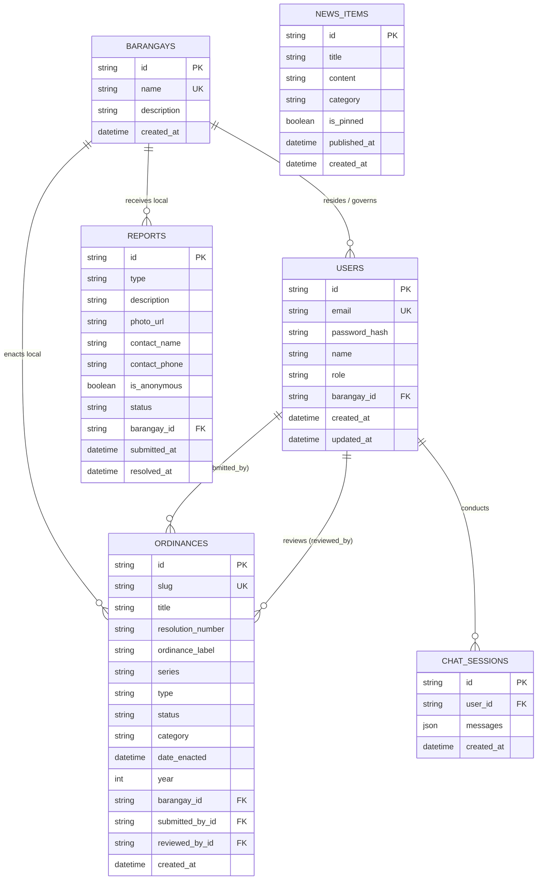

# Cabanatuan City Ordinance Portal — Data Dictionary

This document serves as the comprehensive data dictionary for the **Web-Based AI-Assisted Ordinance Information System (Cabanatuan City Ordinance Portal)**. It details the database schema, entity structures, field specifications, data types, constraints, and relationships implemented in the system.

---

## 1. Database Architecture Overview

The Cabanatuan City Ordinance Portal utilizes a relational database architecture managed through **Prisma ORM (v7)** with an underlying SQLite 3 database engine (`dev.db`), fully compatible with PostgreSQL and MySQL relational databases.

- **Primary Key Convention:** All primary keys utilize collision-resistant unique identifiers (`cuid()`), stored as variable-length character strings (`VARCHAR(30)`).
- **Referential Integrity:** Foreign keys enforce strict referential constraints. Nullable foreign keys implement `ON DELETE SET NULL` to preserve historical integrity upon record deletion, while critical relationship keys enforce strict reference dependencies.
- **Audit Columns:** Standard tracking attributes (`created_at`, `updated_at`, `submitted_at`, `published_at`) capture timestamps automatically via database default triggers (`CURRENT_TIMESTAMP`).

---

## 2. Table Index

| Table Number | Physical Table Name | Prisma Model | Functional Scope / Domain |
|:---:|:---|:---|:---|
| **Table 12** | `users` | `User` | User accounts, credentials, and role-based access control (RBAC). |
| **Table 13** | `barangays` | `Barangay` | Geopolitical barangay jurisdictions within Cabanatuan City. |
| **Table 14** | `ordinances` | `Ordinance` | City and barangay legislative ordinances, resolutions, and metadata. |
| **Table 15** | `reports` | `Report` | Citizen ordinance violation complaints and resolution tracking. |
| **Table 16** | `news_items` | `NewsItem` | Public announcements, advisories, and legislative news bulletins. |
| **Table 17** | `chat_sessions` | `ChatSession` | AI ordinance consultation sessions and dialogue logs. |

> **Note on Table Numbering:** In academic thesis and capstone manuscripts, these data dictionary tables succeed the evaluation rubrics and methodology tables (Tables 1–11 in Chapter 3). For standalone technical documentation, they may also be referenced sequentially as Tables 1 through 6.

---

## 3. Data Dictionary Tables

Table 12 outlines the data dictionary for the users table. It covers the fields used for authentication, account management, and role-based access control (RBAC), including user identity, credentials, administrative role designation, barangay affiliation, and audit timestamps.

### Table 12
*Data dictionary for table users*

| Field Name | Data Type | Length | Key | Null | Default | Description |
|---|---|:---:|:---:|:---:|---|---|
| id | VARCHAR | 30 | PK | No | cuid() | Unique identifier for the user account generated via CUID. |
| email | VARCHAR | 255 | UK | No | — | Unique institutional or personal email address used as login credential. |
| password_hash | VARCHAR | 255 | — | No | — | Salted and hashed password string (Bcrypt) for secure authentication. |
| name | VARCHAR | 255 | — | No | — | Full legal name of the user or government official. |
| role | VARCHAR | 20 | — | No | CITIZEN | System access role controlling portal permissions (`CITIZEN`, `BARANGAY_ADMIN`, `LGU_ADMIN`). |
| barangay_id | VARCHAR | 30 | FK | Yes | NULL | References `barangays.id` of user's resident or administrative barangay (set NULL on delete). |
| created_at | DATETIME | — | — | No | CURRENT_TIMESTAMP | Timestamp indicating when the user account was registered. |
| updated_at | DATETIME | — | — | No | CURRENT_TIMESTAMP | Timestamp indicating when the user record was last modified. |

---

Table 13 outlines the data dictionary for the barangays table. It covers the geopolitical jurisdiction units within Cabanatuan City, including official barangay name, jurisdiction description, and system registration timestamp.

### Table 13
*Data dictionary for table barangays*

| Field Name | Data Type | Length | Key | Null | Default | Description |
|---|---|:---:|:---:|:---:|---|---|
| id | VARCHAR | 30 | PK | No | cuid() | Unique identifier of the barangay record generated via CUID. |
| name | VARCHAR | 255 | UK | No | — | Official unique name of the barangay within Cabanatuan City. |
| description | TEXT | — | — | Yes | NULL | Administrative background, contact notes, or participation status in the portal. |
| created_at | DATETIME | — | — | No | CURRENT_TIMESTAMP | Timestamp indicating when the barangay was registered in the portal. |

---

Table 14 outlines the data dictionary for the ordinances table. It covers the comprehensive legislative records for city and barangay ordinances, including title, resolution numbers, series, status, legislative text, sanctions, enacting authorities, review lifecycle, and document attachments.

### Table 14
*Data dictionary for table ordinances*

| Field Name | Data Type | Length | Key | Null | Default | Description |
|---|---|:---:|:---:|:---:|---|---|
| id | VARCHAR | 30 | PK | No | cuid() | Unique identifier of the ordinance record generated via CUID. |
| slug | VARCHAR | 255 | UK | No | — | URL-friendly unique slug generated from resolution number and title for SEO and routing. |
| title | VARCHAR | 255 | — | No | — | Official title or short title of the ordinance or legislative enactment. |
| resolution_number | VARCHAR | 100 | — | No | — | Official legislative resolution number or ordinance number assigned by the Sanggunian. |
| ordinance_label | VARCHAR | 100 | — | Yes | NULL | Classification prefix or formal designation label (e.g., "City Ordinance", "Barangay Ordinance"). |
| series | VARCHAR | 50 | — | Yes | NULL | Legislative series year designation (e.g., "Series of 2024"). |
| type | VARCHAR | 20 | — | No | BARANGAY | Legislative jurisdiction level (`BARANGAY` or `CITY`). |
| status | VARCHAR | 20 | — | No | DRAFT | Workflow publication state (`DRAFT`, `PENDING`, `APPROVED`, `REJECTED`). |
| description | TEXT | — | — | Yes | NULL | Summary, explanatory note, or executive abstract of the ordinance. |
| content | TEXT | — | — | Yes | NULL | Full text transcript and statutory clauses of the ordinance. |
| category | VARCHAR | 100 | — | Yes | General | Policy domain classification (e.g., Peace & Order, Health, Traffic, Environment, General). |
| penalties | TEXT | — | — | Yes | NULL | Detailed sanctions, fines, and penalties prescribed for ordinance violations. |
| signatories | TEXT | — | — | Yes | NULL | Names and designations of sponsoring councilors, presiding officers, or approving executives. |
| pdf_url | VARCHAR | 500 | — | Yes | NULL | File storage path or external URL to the scanned, signed official PDF copy. |
| date_enacted | DATETIME | — | — | Yes | NULL | Official calendar date when the ordinance was enacted into law. |
| year | INTEGER | 4 | — | Yes | NULL | Calendar year of enactment extracted for indexing and temporal range filtering. |
| tags | JSON | — | — | No | [] | JSON array of semantic keywords and index tags for search and AI query retrieval. |
| coverage | VARCHAR | 255 | — | Yes | NULL | Geographic or territorial scope covered by the ordinance provisions. |
| articles | TEXT | — | — | Yes | NULL | Structured article and section breakdown parsed from the original document. |
| enforcement | TEXT | — | — | Yes | NULL | Designated implementing agencies and enforcement protocols (e.g., PNP, POSO, Tanod). |
| barangay_id | VARCHAR | 30 | FK | Yes | NULL | References `barangays.id` for localized barangay ordinances (NULL for city-wide laws; set NULL on delete). |
| submitted_by_id | VARCHAR | 30 | FK | No | — | References `users.id` of the official who drafted or encoded the ordinance submission. |
| reviewed_by_id | VARCHAR | 30 | FK | Yes | NULL | References `users.id` of the administrator who reviewed the submission (set NULL on delete). |
| approved_at | DATETIME | — | — | Yes | NULL | Timestamp when the ordinance was formally approved by the reviewer. |
| rejected_reason | TEXT | — | — | Yes | NULL | Administrative comments and reasons provided if the submission was rejected. |
| created_at | DATETIME | — | — | No | CURRENT_TIMESTAMP | Timestamp indicating when the ordinance draft or record was created. |
| updated_at | DATETIME | — | — | No | CURRENT_TIMESTAMP | Timestamp indicating when the ordinance record was last modified. |

---

Table 15 outlines the data dictionary for the reports table. It covers the fields used for recording citizen ordinance violation reports, including the violation type, incident description, photo evidence, citizen contact details, anonymous flag, resolution status, jurisdiction barangay, and audit timestamps.

### Table 15
*Data dictionary for table reports*

| Field Name | Data Type | Length | Key | Null | Default | Description |
|---|---|:---:|:---:|:---:|---|---|
| id | VARCHAR | 30 | PK | No | cuid() | Unique identifier of the citizen incident report generated via CUID. |
| type | VARCHAR | 50 | — | No | — | Classification of the reported ordinance violation (`TRASH_BURNING`, `NOISE`, `ROAD_OBSTRUCTION`, `OTHER`). |
| description | TEXT | — | — | No | — | Detailed factual narrative describing the incident, location, and observed violation. |
| photo_url | VARCHAR | 500 | — | Yes | NULL | Storage path or URL of uploaded photographic evidence documenting the incident. |
| contact_name | VARCHAR | 255 | — | Yes | NULL | Full name of the reporting citizen (omitted or NULL if submitted anonymously). |
| contact_phone | VARCHAR | 50 | — | Yes | NULL | Contact mobile number of the reporting citizen for status updates and verification. |
| is_anonymous | BOOLEAN | 1 | — | No | false | Flag indicating whether the citizen chose to submit without disclosing identity. |
| status | VARCHAR | 20 | — | No | NEW | Investigation and resolution lifecycle status (`NEW`, `IN_PROGRESS`, `RESOLVED`, `DISMISSED`). |
| barangay_id | VARCHAR | 30 | FK | No | — | References `barangays.id` identifying the local jurisdiction where the incident occurred. |
| submitted_at | DATETIME | — | — | No | CURRENT_TIMESTAMP | Timestamp when the incident report was submitted by the citizen. |
| resolved_at | DATETIME | — | — | Yes | NULL | Timestamp when the incident report was marked as resolved or dismissed. |

---

Table 16 outlines the data dictionary for the news_items table. It covers the fields used for publishing civic announcements, legislative updates, and public notices, including headline, body content, target scope category, pinned status, publication date, and audit timestamps.

### Table 16
*Data dictionary for table news_items*

| Field Name | Data Type | Length | Key | Null | Default | Description |
|---|---|:---:|:---:|:---:|---|---|
| id | VARCHAR | 30 | PK | No | cuid() | Unique identifier of the civic announcement generated via CUID. |
| title | VARCHAR | 255 | — | No | — | Headline or title of the public news advisory or legislative bulletin. |
| content | TEXT | — | — | No | — | Full body text or Markdown-formatted content of the announcement. |
| category | VARCHAR | 20 | — | No | CITY | Scope of the announcement (`CITY` for city-wide or `BARANGAY` for local jurisdiction). |
| is_pinned | BOOLEAN | 1 | — | No | false | Flag indicating whether the news item is pinned to the top of notice boards. |
| published_at | DATETIME | — | — | No | CURRENT_TIMESTAMP | Official date and time when the news announcement was released to the public. |
| created_at | DATETIME | — | — | No | CURRENT_TIMESTAMP | Timestamp indicating when the announcement record was created. |
| updated_at | DATETIME | — | — | No | CURRENT_TIMESTAMP | Timestamp indicating when the announcement record was last modified. |

---

Table 17 outlines the data dictionary for the chat_sessions table. It covers the fields used for logging AI ordinance consultation sessions conducted by citizens, including user attribution, structured dialogue messages, and session creation timestamp.

### Table 17
*Data dictionary for table chat_sessions*

| Field Name | Data Type | Length | Key | Null | Default | Description |
|---|---|:---:|:---:|:---:|---|---|
| id | VARCHAR | 30 | PK | No | cuid() | Unique identifier of the AI chatbot consultation session generated via CUID. |
| user_id | VARCHAR | 30 | FK | Yes | NULL | References `users.id` if the user was authenticated (NULL for guest citizens; set NULL on delete). |
| messages | JSON | — | — | No | [] | Serialized JSON array containing conversation history (user queries and AI responses). |
| created_at | DATETIME | — | — | No | CURRENT_TIMESTAMP | Timestamp indicating when the chatbot consultation session was initiated. |

---

## 4. Enumerated Types (Enums) Reference

The system employs TypeScript and database-level enumerations to guarantee data integrity across critical workflows:

| Enum Name | Allowed Values | Target Field(s) | Business Logic / Scope |
|---|---|---|---|
| `UserRole` | `CITIZEN`, `BARANGAY_ADMIN`, `LGU_ADMIN` | `users.role` | Defines access boundaries: public citizen inquiries, barangay-level management, or city-wide LGU governance. |
| `OrdinanceType` | `BARANGAY`, `CITY` | `ordinances.type` | Differentiates local barangay resolutions from city-wide municipal ordinances. |
| `OrdinanceStatus` | `DRAFT`, `PENDING`, `APPROVED`, `REJECTED` | `ordinances.status` | Enforces the four-stage legislative review and publication workflow. |
| `ReportType` | `TRASH_BURNING`, `NOISE`, `ROAD_OBSTRUCTION`, `OTHER` | `reports.type` | Categorizes citizen complaints for automatic routing to the relevant barangay authority. |
| `ReportStatus` | `NEW`, `IN_PROGRESS`, `RESOLVED`, `DISMISSED` | `reports.status` | Tracks the lifecycle of reported civic violations from filing to barangay resolution. |
| `NewsCategory` | `CITY`, `BARANGAY` | `news_items.category` | Controls the target audience and broadcast scope of civic announcements. |

---

## 5. Database Indexes and Performance Optimization

To ensure sub-second query response times across hundreds of legislative records and reports, explicit indexes are defined in `prisma/schema.prisma`:

| Table Name | Index Type | Indexed Column(s) | Optimization Purpose |
|---|---|---|---|
| `users` | Unique | `email` | Rapid credential lookups during user login. |
| `users` | Single Index | `role` | Filtering accounts by administrative permission level. |
| `users` | Single Index | `barangay_id` | Scoping user queries by specific barangay. |
| `barangays` | Unique | `name` | Preventing duplicate barangay registrations. |
| `ordinances` | Unique | `slug` | Direct O(1) lookup for public ordinance details via URL slug. |
| `ordinances` | Single Index | `status` | Review queue filtering (`PENDING`, `APPROVED`, `DRAFT`). |
| `ordinances` | Single Index | `type` | Separating City vs. Barangay ordinances. |
| `ordinances` | Single Index | `category` | Public explorer category filtering. |
| `ordinances` | Single Index | `year` | Temporal range filtering across legislative periods. |
| `ordinances` | Single Index | `date_enacted` | Sorting ordinances by chronological enactment order. |
| `ordinances` | Composite Index | `[status, category]` | Multi-facet filtering on the public ordinance explorer. |
| `ordinances` | Composite Index | `[status, year]` | Multi-facet filtering on the public ordinance explorer. |
| `ordinances` | Single Index | `barangay_id` | Scoping ordinances to specific barangays. |
| `ordinances` | Single Index | `submitted_by_id` | Tracking author contributions and draft submissions. |
| `reports` | Single Index | `status` | Barangay admin dashboard report triage (`NEW`, `IN_PROGRESS`). |
| `reports` | Single Index | `barangay_id` | Filtering complaints to their respective barangay jurisdiction. |
| `reports` | Single Index | `type` | Aggregating report analytics by violation category. |
| `reports` | Single Index | `submitted_at` | Chronological sorting and time-series report trends. |
| `news_items` | Single Index | `category` | Filtering news bulletins by City vs. Barangay scope. |
| `news_items` | Single Index | `is_pinned` | Prioritizing pinned alerts at the top of bulletin boards. |
| `chat_sessions` | Single Index | `user_id` | Retrieving prior consultation sessions for authenticated users. |

---

## 6. Entity-Relationship Overview

