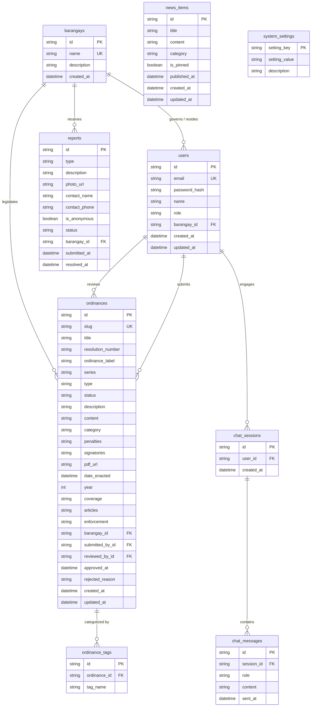

# Database Normalization (UNF, 1NF, 2NF, 3NF)
## Web-Based AI-Assisted Ordinance Information System (Cabanatuan City Ordinance Portal)

---

### Executive Overview

Database normalization is a systematic design technique pioneered by Edgar F. Codd that organizes relational tables to minimize data redundancy, avoid anomalies during data manipulation (insert, update, delete), and ensure that data dependencies make logical sense. 

This document traces the complete normalization journey of the **Cabanatuan City Ordinance Portal** from an **Unnormalized Form (UNF)** to the fully optimized **Third Normal Form (3NF)**, conforming directly with the system's operational architecture and Prisma schema.

```
┌─────────────────────────────────┐
│  Unnormalized Form (UNF)        │  Monolithic data structure with repeating groups & non-atomic fields
└────────────────┬────────────────┘
                 │
                 ▼  Rule 1: Eliminate repeating groups, flatten attributes, assign primary keys
┌─────────────────────────────────┐
│  First Normal Form (1NF)        │  Atomic attributes, atomic rows, composite primary keys on child relations
└────────────────┬────────────────┘
                 │
                 ▼  Rule 2: Eliminate partial functional dependencies on composite keys
┌─────────────────────────────────┐
│  Second Normal Form (2NF)       │  Full functional dependency on entire PK; surrogate keys introduced
└────────────────┬────────────────┘
                 │
                 ▼  Rule 3: Eliminate transitive functional dependencies (X → Y → Z)
┌─────────────────────────────────┐
│  Third Normal Form (3NF)        │  Strict dependency on the key, the whole key, and nothing but the key
└─────────────────────────────────┘
```

---

## 1. Summary of Normalization Stages

| Normal Form | Core Criterion / Rule Applied | System Structural Transformations | Anomalies Resolved |
|---|---|---|---|
| **UNF** | Initial flat collection of all portal data attributes without relational modeling. | A single composite record containing nested collections: `{ Ordinances }`, `{ Ordinance Tags }`, `{ Community Reports }`, `{ Civic News Items }`, `{ AI Chat Sessions }`, `{ Chat Messages }`. | Severe insertion, modification, and deletion anomalies. Extreme data duplication. |
| **1NF** | Eliminate repeating groups; ensure all attributes are atomic; define primary keys. | Decomposed into 9 distinct relations: `USER_1NF`, `BARANGAY_1NF`, `ORDINANCE_1NF`, `ORDINANCE_TAG_1NF`, `COMMUNITY_REPORT_1NF`, `CIVIC_NEWS_1NF`, `CHAT_SESSION_1NF`, `CHAT_MESSAGE_1NF`, `SYSTEM_SETTING_1NF`. Composite keys assigned to child tables. | Multi-valued and nested array anomalies resolved. Redundancy still persists across parent-child relationships. |
| **2NF** | In 1NF + eliminate partial functional dependencies (where non-key fields depend on only part of a composite key). | Resolved composite keys into dedicated entities with surrogate primary keys (`tag_id`, `message_id`). Foreign keys (`FK`) explicitly established. Transitive attributes retained for demonstration. | Partial dependency anomalies resolved; individual tag and message lifecycle independent of parent records. |
| **3NF** | In 2NF + eliminate transitive functional dependencies (where non-key fields depend on other non-key fields). | Removed all duplicate denormalized lookup attributes (`barangay_name`, `submitted_by_name`, `reviewed_by_name`, `user_name`, `user_email`). Tables converted to production physical schema (`users`, `barangays`, `ordinances`, etc.). | Transitive update anomalies and data divergence completely eliminated. 100% referential integrity. |

---

## 2. Stage 1: Unnormalized Form (UNF)

### 2.1 Description & Schema Definition

In **Unnormalized Form (UNF)**, all data attributes managed by the Cabanatuan City Ordinance Portal are represented as a single monolithic record. This structure models how data would appear if stored in an unparsed flat spreadsheet or monolithic document containing nested repeating groups.

#### Formal UNF Representation:
```text
CABANATUAN_ORDINANCE_HUB_RECORD = (
    user_id, name, email, password_hash, role, user_created_at, user_updated_at,
    barangay_name, barangay_description, barangay_created_at,
    official_title, authorization_level, department,
    { Ordinances: ordinance_id, slug, title, resolution_number, ordinance_label, series,
                  type, status, description, content, category, penalties, signatories,
                  pdf_url, date_enacted, year, coverage, articles, enforcement,
                  ordinance_barangay_name, submitted_by_name, submitted_by_email,
                  reviewed_by_name, reviewed_by_email, approved_at, rejected_reason,
                  ordinance_created_at, ordinance_updated_at,
                  { Ordinance Tags: tag_name } },
    { Community Reports: report_id, report_type, report_description, photo_url,
                         contact_name, contact_phone, is_anonymous, report_status,
                         report_barangay_name, report_submitted_at, report_resolved_at },
    { Civic News Items: news_id, news_title, news_content, news_category, is_pinned,
                        published_at, news_created_at, news_updated_at },
    { AI Chat Sessions: session_id, session_user_name, session_created_at,
                        { Chat Messages: message_id, message_role, message_content, sent_at } },
    rag_top_k, similarity_threshold, ai_model_name, ai_temperature,
    max_context_length, allowed_file_types, max_upload_size_mb
)
```

### 2.2 Inherent Database Anomalies in UNF

1. **Insertion Anomaly:**
   - A new barangay (e.g., *Barangay San Josef Sur*) cannot be added to the system unless at least one user or ordinance already exists for that barangay.
   - An administrator cannot record system configuration settings without creating a dummy user or ordinance record.
2. **Update / Modification Anomaly:**
   - If an LGU reviewer changes their legal name or email address, every ordinance record they previously reviewed must be individually updated across the database. Any missed record results in conflicting data.
   - If the description or coverage of a barangay changes, it must be updated across all associated users, ordinances, and community complaints.
3. **Deletion Anomaly:**
   - If the last community report from a specific barangay is resolved and purged, all record of that barangay's reporting history could inadvertently be lost if no separate barangay entity exists.
   - Deleting a citizen account removes all chat consultation history associated with that user.

---

## 3. Stage 2: First Normal Form (1NF)

### 3.1 Normalization Process from UNF to 1NF

To transform UNF into **First Normal Form (1NF)**:
1. **Eliminate Repeating Groups:** Every nested collection (`{ Ordinances }`, `{ Ordinance Tags }`, `{ Community Reports }`, `{ Civic News Items }`, `{ AI Chat Sessions }`, `{ Chat Messages }`) is extracted into its own distinct relation.
2. **Ensure Atomicity:** Every attribute contains only atomic (indivisible) scalar values (no JSON arrays or multi-value strings).
3. **Establish Primary Keys:** Every table is assigned a primary key (underlined). Child tables formed from repeating groups receive composite primary keys to uniquely distinguish each repeated instance.

### 3.2 1NF Relational Relations

#### `USER_1NF`
- **PK:** `<u>user_id</u>`
- **Attributes:** `email`, `password_hash`, `name`, `role`, `barangay_id`, `barangay_name`, `created_at`, `updated_at`

#### `BARANGAY_1NF`
- **PK:** `<u>barangay_id</u>`
- **Attributes:** `name`, `description`, `created_at`

#### `ORDINANCE_1NF`
- **PK:** `<u>ordinance_id</u>`
- **Attributes:** `slug`, `title`, `resolution_number`, `ordinance_label`, `series`, `type`, `status`, `description`, `content`, `category`, `penalties`, `signatories`, `pdf_url`, `date_enacted`, `year`, `coverage`, `articles`, `enforcement`, `barangay_id`, `barangay_name`, `submitted_by_id`, `submitted_by_name`, `reviewed_by_id`, `reviewed_by_name`, `approved_at`, `rejected_reason`, `created_at`, `updated_at`

#### `ORDINANCE_TAG_1NF`
- **PK:** `<u>ordinance_id</u>`, `<u>tag_name</u>` *(Composite Primary Key)*
- **Attributes:** None (pure associative key pair)

#### `COMMUNITY_REPORT_1NF`
- **PK:** `<u>report_id</u>`
- **Attributes:** `type`, `description`, `photo_url`, `contact_name`, `contact_phone`, `is_anonymous`, `status`, `barangay_id`, `barangay_name`, `submitted_at`, `resolved_at`

#### `CIVIC_NEWS_1NF`
- **PK:** `<u>news_id</u>`
- **Attributes:** `title`, `content`, `category`, `is_pinned`, `published_at`, `created_at`, `updated_at`

#### `CHAT_SESSION_1NF`
- **PK:** `<u>session_id</u>`
- **Attributes:** `user_id`, `user_name`, `user_email`, `created_at`

#### `CHAT_MESSAGE_1NF`
- **PK:** `<u>session_id</u>`, `<u>message_id</u>` *(Composite Primary Key)*
- **Attributes:** `role`, `content`, `sent_at`

#### `SYSTEM_SETTING_1NF`
- **PK:** `<u>setting_key</u>`
- **Attributes:** `setting_value`, `description`

---

## 4. Stage 3: Second Normal Form (2NF)

### 4.1 Normalization Process from 1NF to 2NF

A relation is in **Second Normal Form (2NF)** if and only if:
1. It is already in **1NF**.
2. All non-prime attributes are **fully functionally dependent** on the whole primary key (no **partial functional dependencies**).

#### Analysis of Partial Dependencies in 1NF:
- In `CHAT_MESSAGE_1NF` with composite primary key (`session_id`, `message_id`):
  - $\text{message\_id} \to \{\text{role}, \text{content}, \text{sent\_at}\}$
  - The message attributes depend solely on `message_id`, not on the composite combination of `session_id` and `message_id`.
  - **Resolution:** Convert `message_id` into a distinct primary key and define `session_id` as a foreign key (`FK`).
- In `ORDINANCE_TAG_1NF` with composite primary key (`ordinance_id`, `tag_name`):
  - Assign a unique surrogate key `tag_id` (`PK`) with `ordinance_id` designated as a foreign key (`FK`).

#### Retained Transitive Dependencies in 2NF:
As standard in normalization step progression, 2NF eliminates partial dependencies, but **transitive dependencies are preserved at this stage** for clarity:
- In `ORDINANCES_2NF`: `barangay_name` depends on `barangay_id`; `submitted_by_name` depends on `submitted_by_id`; `reviewed_by_name` depends on `reviewed_by_id`.
- In `USERS_2NF`: `barangay_name` depends on `barangay_id`.
- In `COMMUNITY_REPORTS_2NF`: `barangay_name` depends on `barangay_id`.
- In `CHAT_SESSIONS_2NF`: `user_name` and `user_email` depend on `user_id`.

### 4.2 2NF Relational Relations

- `USERS_2NF` (PK: `<u>user_id</u>`, UQ: `email`, `password_hash`, `name`, `role`, FK: `*barangay_id*`, `barangay_name`, `created_at`, `updated_at`)
- `BARANGAYS_2NF` (PK: `<u>barangay_id</u>`, UQ: `name`, `description`, `created_at`)
- `ORDINANCES_2NF` (PK: `<u>ordinance_id</u>`, UQ: `slug`, `title`, `resolution_number`, `ordinance_label`, `series`, `type`, `status`, `description`, `content`, `category`, `penalties`, `signatories`, `pdf_url`, `date_enacted`, `year`, `coverage`, `articles`, `enforcement`, FK: `*barangay_id*`, `barangay_name`, FK: `*submitted_by_id*`, `submitted_by_name`, FK: `*reviewed_by_id*`, `reviewed_by_name`, `approved_at`, `rejected_reason`, `created_at`, `updated_at`)
- `ORDINANCE_TAGS_2NF` (PK: `<u>tag_id</u>`, FK: `*ordinance_id*`, `tag_name`)
- `COMMUNITY_REPORTS_2NF` (PK: `<u>report_id</u>`, `type`, `description`, `photo_url`, `contact_name`, `contact_phone`, `is_anonymous`, `status`, FK: `*barangay_id*`, `barangay_name`, `submitted_at`, `resolved_at`)
- `CIVIC_NEWS_2NF` (PK: `<u>news_id</u>`, `title`, `content`, `category`, `is_pinned`, `published_at`, `created_at`, `updated_at`)
- `CHAT_SESSIONS_2NF` (PK: `<u>session_id</u>`, FK: `*user_id*`, `user_name`, `user_email`, `created_at`)
- `CHAT_MESSAGES_2NF` (PK: `<u>message_id</u>`, FK: `*session_id*`, `role`, `content`, `sent_at`)
- `SYSTEM_SETTINGS_2NF` (PK: `<u>setting_key</u>`, `setting_value`, `description`)

---

## 5. Stage 4: Third Normal Form (3NF)

### 5.1 Normalization Process from 2NF to 3NF

A relation is in **Third Normal Form (3NF)** if and only if:
1. It is in **2NF**.
2. There are **no transitive functional dependencies** ($X \to Y$ and $Y \to Z$, where $X$ is the primary key and $Y$ and $Z$ are non-prime attributes). Every non-key attribute must depend *only on the primary key, the whole key, and nothing but the key*.

#### Elimination of Transitive Dependencies:
1. **From `ORDINANCES_2NF`:**
   - Remove `barangay_name` (determined by `barangay_id` $\to$ retrieved via `barangays` relation).
   - Remove `submitted_by_name` (determined by `submitted_by_id` $\to$ retrieved via `users` relation).
   - Remove `reviewed_by_name` (determined by `reviewed_by_id` $\to$ retrieved via `users` relation).
2. **From `USERS_2NF`:**
   - Remove `barangay_name` (determined by `barangay_id` $\to$ retrieved via `barangays` relation).
3. **From `COMMUNITY_REPORTS_2NF`:**
   - Remove `barangay_name` (determined by `barangay_id` $\to$ retrieved via `barangays` relation).
4. **From `CHAT_SESSIONS_2NF`:**
   - Remove `user_name` and `user_email` (determined by `user_id` $\to$ retrieved via `users` relation).

### 5.2 Final 3NF Production Relational Schema

The resulting 3NF physical schema perfectly matches the **Prisma ORM schema (`schema.prisma`)** and relational database tables:

#### 1. `users`
| Key | Field Name | Data Type | Nullable | Constraints & Description |
|:---:|---|:---:|:---:|---|
| **PK** | `<u>id</u>` | VARCHAR(30) | No | Unique user identifier (CUID). |
| **UQ** | `email` | VARCHAR(255) | No | Unique account email for authentication. |
| | `password_hash` | VARCHAR(255) | No | Salted Bcrypt password hash. |
| | `name` | VARCHAR(255) | No | Full legal name of user or official. |
| | `role` | VARCHAR(20) | No | System role: `CITIZEN`, `BARANGAY_ADMIN`, `LGU_ADMIN`. |
| **FK** | `*barangay_id*` | VARCHAR(30) | Yes | References `barangays(id)`. Set NULL on delete. |
| | `created_at` | DATETIME | No | Registration timestamp (`now()`). |
| | `updated_at` | DATETIME | No | Last modification timestamp (`updatedAt`). |

#### 2. `barangays`
| Key | Field Name | Data Type | Nullable | Constraints & Description |
|:---:|---|:---:|:---:|---|
| **PK** | `<u>id</u>` | VARCHAR(30) | No | Unique barangay identifier (CUID). |
| **UQ** | `name` | VARCHAR(255) | No | Official unique barangay jurisdiction name. |
| | `description` | TEXT | Yes | Administrative notes or territorial background. |
| | `created_at` | DATETIME | No | System registration timestamp. |

#### 3. `ordinances`
| Key | Field Name | Data Type | Nullable | Constraints & Description |
|:---:|---|:---:|:---:|---|
| **PK** | `<u>id</u>` | VARCHAR(30) | No | Unique ordinance identifier (CUID). |
| **UQ** | `slug` | VARCHAR(255) | No | Unique URL-safe slug for routing and indexing. |
| | `title` | VARCHAR(255) | No | Official title of ordinance or enactment. |
| | `resolution_number` | VARCHAR(100) | No | Assigned legislative resolution/ordinance number. |
| | `ordinance_label` | VARCHAR(100) | Yes | Formal prefix label (e.g., "City Ordinance"). |
| | `series` | VARCHAR(50) | Yes | Legislative series year (e.g., "Series of 2024"). |
| | `type` | VARCHAR(20) | No | Jurisdiction level: `BARANGAY` or `CITY`. |
| | `status` | VARCHAR(20) | No | Workflow status: `DRAFT`, `PENDING`, `APPROVED`, `REJECTED`. |
| | `description` | TEXT | Yes | Executive summary or policy overview. |
| | `content` | TEXT | Yes | Full verbatim transcript of legal enactment. |
| | `category` | VARCHAR(100) | Yes | Domain: Peace & Order, Health, Traffic, Environment, etc. |
| | `penalties` | TEXT | Yes | Prescribed fines, sanctions, and violation remedies. |
| | `signatories` | TEXT | Yes | Names and titles of presiding legislative officials. |
| | `pdf_url` | VARCHAR(500) | Yes | File storage path or URL to signed official PDF document. |
| | `date_enacted` | DATETIME | Yes | Official calendar date of passage. |
| | `year` | INTEGER | Yes | Year of enactment for temporal filtering. |
| | `coverage` | VARCHAR(255) | Yes | Territorial boundary or geographic jurisdiction. |
| | `articles` | TEXT | Yes | Structured statutory clauses and section breakdown. |
| | `enforcement` | TEXT | Yes | Designated enforcement bodies (POSO, PNP, Tanod). |
| **FK** | `*barangay_id*` | VARCHAR(30) | Yes | References `barangays(id)` (NULL for city-wide laws). |
| **FK** | `*submitted_by_id*` | VARCHAR(30) | No | References `users(id)` of authoring official. |
| **FK** | `*reviewed_by_id*` | VARCHAR(30) | Yes | References `users(id)` of reviewing administrator. |
| | `approved_at` | DATETIME | Yes | Review approval timestamp. |
| | `rejected_reason` | TEXT | Yes | Rejection reason/feedback notes. |
| | `created_at` | DATETIME | No | Draft creation timestamp. |
| | `updated_at` | DATETIME | No | Record update timestamp. |

#### 4. `ordinance_tags`
| Key | Field Name | Data Type | Nullable | Constraints & Description |
|:---:|---|:---:|:---:|---|
| **PK** | `<u>id</u>` | VARCHAR(30) | No | Unique tag record identifier. |
| **FK** | `*ordinance_id*` | VARCHAR(30) | No | References `ordinances(id)`. Cascade on delete. |
| | `tag_name` | VARCHAR(100) | No | Curated keyword token for search and RAG indexing. |

#### 5. `reports`
| Key | Field Name | Data Type | Nullable | Constraints & Description |
|:---:|---|:---:|:---:|---|
| **PK** | `<u>id</u>` | VARCHAR(30) | No | Unique report ticket identifier (CUID). |
| | `type` | VARCHAR(30) | No | Violation category: `TRASH_BURNING`, `NOISE`, `ROAD_OBSTRUCTION`, `OTHER`. |
| | `description` | TEXT | No | Citizen incident narrative and details. |
| | `photo_url` | VARCHAR(500) | Yes | Uploaded incident evidence photo path. |
| | `contact_name` | VARCHAR(255) | Yes | Optional citizen contact name (if not anonymous). |
| | `contact_phone` | VARCHAR(50) | Yes | Optional contact mobile number for verification. |
| | `is_anonymous` | BOOLEAN | No | Anonymity flag (`default: false`). |
| | `status` | VARCHAR(20) | No | Incident lifecycle: `NEW`, `IN_PROGRESS`, `RESOLVED`, `DISMISSED`. |
| **FK** | `*barangay_id*` | VARCHAR(30) | No | References `barangays(id)` of jurisdiction. |
| | `submitted_at` | DATETIME | No | Incident submission timestamp. |
| | `resolved_at` | DATETIME | Yes | Official resolution timestamp. |

#### 6. `news_items`
| Key | Field Name | Data Type | Nullable | Constraints & Description |
|:---:|---|:---:|:---:|---|
| **PK** | `<u>id</u>` | VARCHAR(30) | No | Unique news item identifier (CUID). |
| | `title` | VARCHAR(255) | No | Headline of public advisory or news announcement. |
| | `content` | TEXT | No | Full advisory text or news release. |
| | `category` | VARCHAR(20) | No | Scope: `CITY` or `BARANGAY`. |
| | `is_pinned` | BOOLEAN | No | Sticky bulletin status flag (`default: false`). |
| | `published_at` | DATETIME | No | Official publication timestamp. |
| | `created_at` | DATETIME | No | Creation timestamp. |
| | `updated_at` | DATETIME | No | Last modification timestamp. |

#### 7. `chat_sessions`
| Key | Field Name | Data Type | Nullable | Constraints & Description |
|:---:|---|:---:|:---:|---|
| **PK** | `<u>id</u>` | VARCHAR(30) | No | Unique RAG consultation session identifier (CUID). |
| **FK** | `*user_id*` | VARCHAR(30) | Yes | References `users(id)` (NULL for guest citizens). |
| | `created_at` | DATETIME | No | Session initialization timestamp. |

#### 8. `chat_messages`
| Key | Field Name | Data Type | Nullable | Constraints & Description |
|:---:|---|:---:|:---:|---|
| **PK** | `<u>id</u>` | VARCHAR(30) | No | Unique chat turn identifier. |
| **FK** | `*session_id*` | VARCHAR(30) | No | References `chat_sessions(id)`. Cascade on delete. |
| | `role` | VARCHAR(20) | No | Turn interlocutor: `user` or `assistant`. |
| | `content` | TEXT | No | Prompt query or AI-grounded response text. |
| | `sent_at` | DATETIME | No | Message transmission timestamp. |

#### 9. `system_settings`
| Key | Field Name | Data Type | Nullable | Constraints & Description |
|:---:|---|:---:|:---:|---|
| **PK** | `<u>setting_key</u>` | VARCHAR(100) | No | Configuration key parameter (e.g. `rag_top_k`). |
| | `setting_value` | TEXT | No | Configured runtime value. |
| | `description` | VARCHAR(255) | Yes | Functional explanation of parameter. |

---

## 6. Entity-Relationship (ER) Diagram in 3NF

The diagram below visualizes the 3NF physical schema relationships, primary keys (`PK`), foreign keys (`FK`), and cardinalities:


